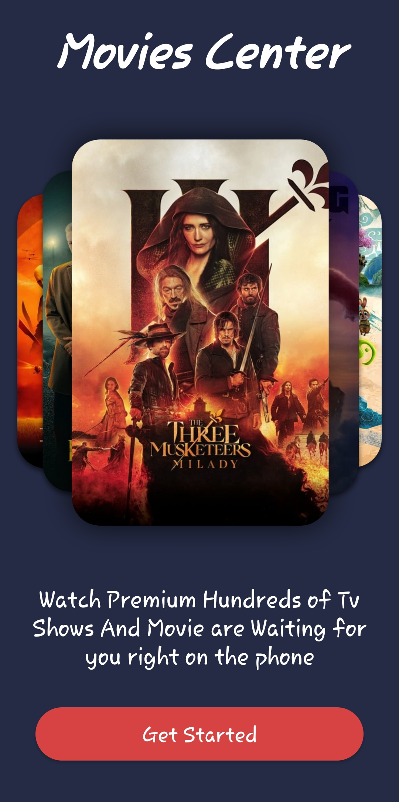
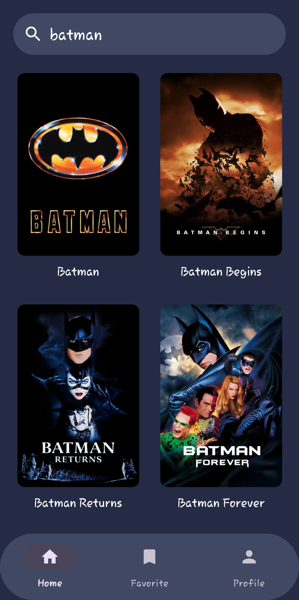
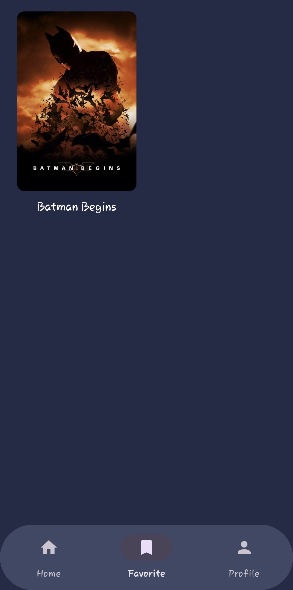

[](https://github.com/asaayuti/movies-app/actions/workflows/android_ci.yml)

# Clean Architecture Movies App

A modern, offline-first Android application that displays popular movies using **The Movie Database (TMDB) API**. Built using **Clean Architecture**, **Modularization (Dynamic Feature)**, **Dagger Hilt**, **RxJava**, **Room with SQLCipher**, and **Retrofit**.

---

## 📱 Screenshots

<table align="center">
  <tr>
    <td align="center">
      <br/>
      <b>Welcome</b>
    </td>
    <td align="center">
      <br/>
      <b>Home & Search</b>
    </td>
    <td align="center">
      <br/>
      <b>Movie Detail</b>
    </td>
    <td align="center">
      <br/>
      <b>Favorites (Dynamic Module)</b>
    </td>
  </tr>
</table>

---

## ✨ Features

- **Movie Discovery**: Browse popular movies fetched from TMDB API.
- **Search Movies**: Real-time movie searching with query handling via RxBinding / RxJava streams.
- **Movie Details**: View comprehensive movie info including backdrop, poster, rating, overview, release date, and interactive bookmarking.
- **Favorite Movies**: Add/remove movies to favorites for quick access, served from a local encrypted database.
- **Offline-First & Caching**: Uses the `NetworkBoundResource` pattern to store data locally and provide seamless offline access.
- **Dynamic Feature Module**: Favorite feature is separated into a dynamic feature module (`:favorite`) loaded on demand.
- **Security & Data Protection**: Enterprise-grade security featuring Room database encryption via **SQLCipher**, API **Certificate Pinning**, and code obfuscation via **R8/ProGuard**.

---

## 🏗️ Architecture & Modularization

The project strictly follows **Clean Architecture** principles to promote separation of concerns, testability, and scalability.

```
                  ┌────────────────────────┐
                  │   Presentation Layer   │
                  │   (UI, ViewModels)     │
                  └───────────┬────────────┘
                              │
                  ┌───────────▼────────────┐
                  │      Domain Layer      │
                  │  (Use Cases, Models)   │
                  └───────────▲────────────┘
                              │
                  ┌───────────┴────────────┘
                  │       Data Layer       │
                  │ (Repositories, Sources)│
                  └────────────────────────┘
```

### Module Structure

- **`:app`** (*Android Application*)
  - UI presentation layer for Home, Movie Details, Welcome, Profile, and main navigation graph.
  - Application entry points and Dagger Hilt dependency container.
- **`:core`** (*Android Library*)
  - Contains shared domain logic, domain models, use cases, repository contracts, and implementations.
  - Handles remote API calls (Retrofit) and local database operations (Room + SQLCipher).
  - Shared UI components, adapters, network helpers, and utility functions.
- **`:favorite`** (*Android Dynamic Feature*)
  - Dynamic feature module for managing favorite movies, built to support dynamic delivery.
  - Injects dependencies from `:app` using Dagger Hilt EntryPoint Accessors.

---

## 🛠️ Tech Stack & Libraries

- **Language**: [Kotlin](https://kotlinlang.org/) (v1.9.22)
- **Dependency Injection**: [Dagger Hilt](https://dagger.dev/hilt/) (v2.48)
- **Reactive Programming**: [RxJava2](https://github.com/ReactiveX/RxJava), RxAndroid, RxBinding
- **Networking**: [Retrofit2](https://square.github.io/retrofit/), OkHttp3, Gson, HttpLoggingInterceptor
- **Local Database**: [Room](https://developer.android.com/training/data-storage/room) with [SQLCipher](https://www.zetetic.net/sqlcipher/) (v4.6.1) for database encryption
- **Annotation Processing**: [KSP](https://kotlinlang.org/docs/ksp-overview.html) & Kapt
- **Navigation**: [Jetpack Navigation Component](https://developer.android.com/guide/navigation)
- **UI & Views**: ViewBinding, Material Design 3 Components, [BlurView](https://github.com/Dimezis/BlurView)
- **Image Loading**: [Glide](https://github.com/bumptech/glide) (v4.16.0)
- **Memory Leak Detection**: [LeakCanary](https://square.github.io/leakcanary/) (debug builds)
- **Security**: OkHttp Certificate Pinning, Room SQLCipher DB Encryption, R8 / ProGuard Obfuscation

---

## 🔒 Security Highlights

1. **Database Encryption**: Encrypts the local Room database using **SQLCipher** to ensure user data remains safe on disk.
2. **Certificate Pinning**: Enforces OkHttp `CertificatePinner` to prevent Man-in-the-Middle (MitM) attacks during SSL communication.
3. **Obfuscation**: Code shrinking, resource optimization, and ProGuard/R8 obfuscation enabled for release & debug configurations.
4. **Environment Protection**: Sensitive parameters (API keys, Base URLs, certificate pins) are securely injected via `local.properties` rather than hardcoded in source control.

---

## 🚀 Setup & Installation

### Prerequisites

- Android Studio Jellyfish (2023.3.1) or newer
- JDK 17
- Android SDK 34
- TMDB API Key (Get one from [The Movie Database](https://www.themoviedb.org/documentation/api))

### Configuration

1. Clone the repository:
   ```bash
   git clone https://github.com/asaayuti/movies-app.git
   cd movies-app
   ```

2. Open `local.properties` in the root directory and add the required properties:
   ```properties
   HOSTNAME=api.themoviedb.org
   BASE_URL=https://api.themoviedb.org/3/
   IMAGE_URL=https://image.tmdb.org/t/p/w500
   API_KEY=YOUR_TMDB_API_KEY
   CERTIFICATE_KEY=YOUR_CERTIFICATE_PIN_OR_SHA256
   ```

3. Sync Gradle and build the project in Android Studio or via CLI:
   ```bash
   ./gradlew assembleDebug
   ```

---

## 📜 License

This project is open source and available under the standard MIT or repository license.
